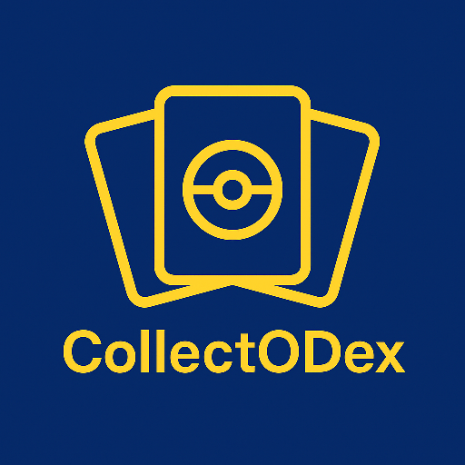
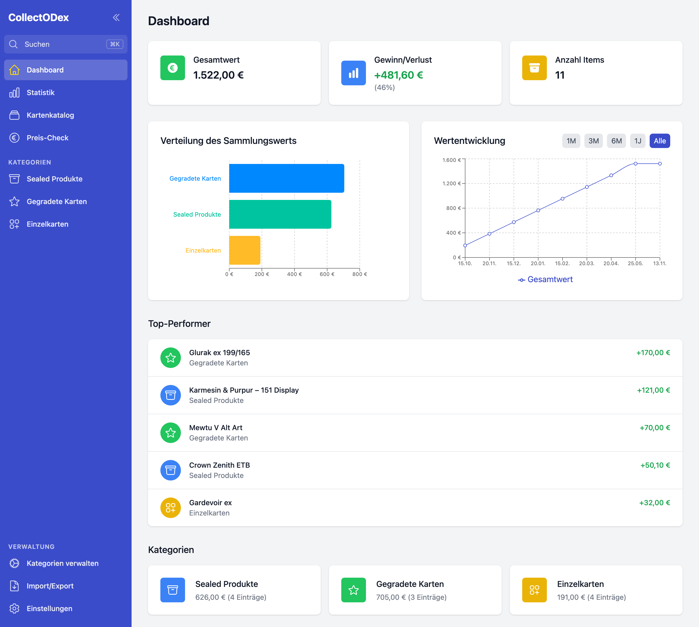
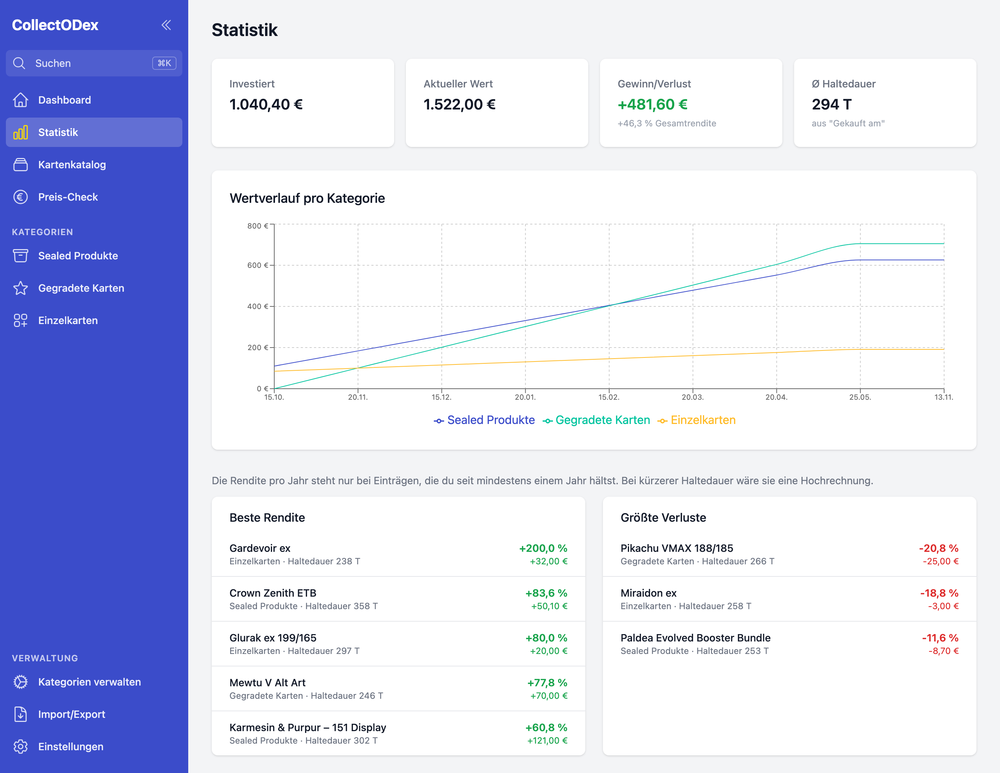
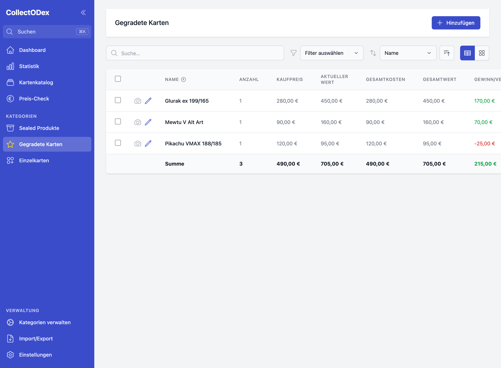
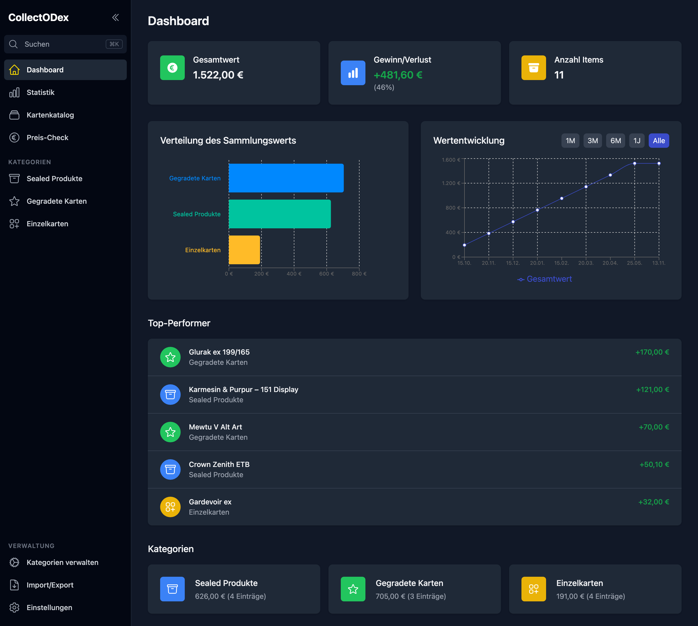
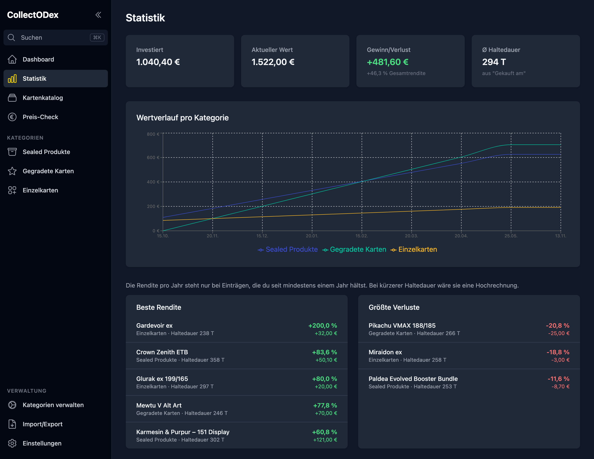
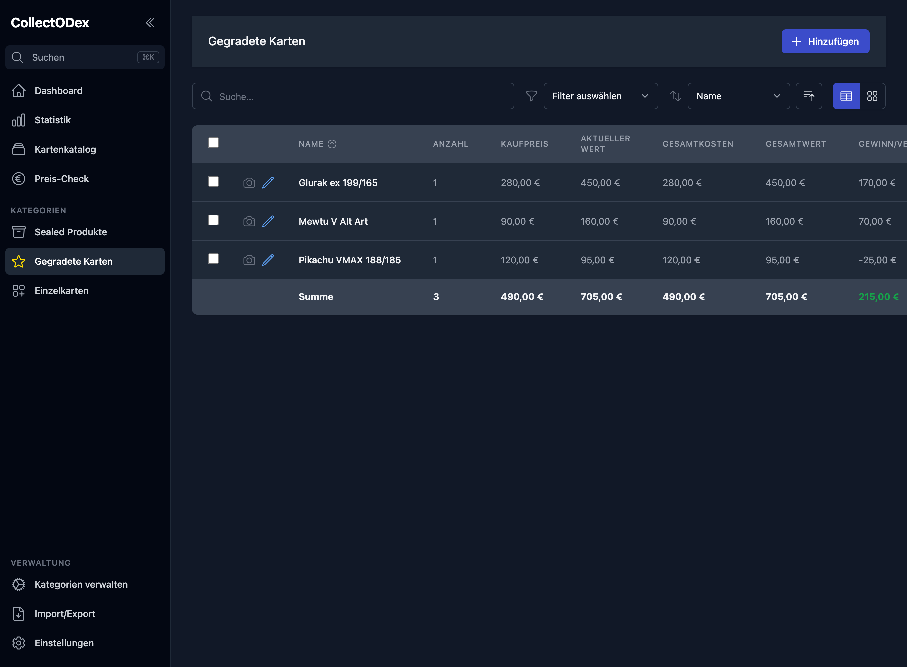

<div align="center">



# CollectODex

**The desktop app for your Pokémon card collection.**
Categorise, value and track your inventory – and see what your collection is worth.

[🇩🇪 Deutsch](README.md) · 🇬🇧 English

[](https://github.com/R0cketBean/collectodex/releases/latest)
[](https://github.com/R0cketBean/collectodex/releases)
[](https://github.com/R0cketBean/collectodex/actions/workflows/build.yml)
[](LICENSE)


[**⬇️ Download**](https://github.com/R0cketBean/collectodex/releases/latest) · [Landing page](https://r0cketbean.github.io/collectodex/) · [Roadmap](https://github.com/R0cketBean/collectodex/milestones)

</div>

---

<div align="center">
  
</div>

## What is CollectODex?

CollectODex is a local desktop app for managing your Pokémon collection in a
structured way – from sealed product and graded cards to singles and any custom
categories you like. All data stays on your machine; nothing is uploaded to a
cloud.

## Features

- 📦 **Flexible categories** – sealed, graded, singles, or your own categories with freely defined attributes.
- 🃏 **Card catalogue** – browse sets in German, English and Japanese, tick off the cards you own and add them to your collection with their image.
- 💶 **Price check** – compare your own values with the catalogue price and see which prices are due for an update.
- 📊 **Dashboard** – total value, profit/loss, value distribution and value trend at a glance.
- 📈 **Statistics** – return per item, holding period, biggest losses and value history per category.
- 🧮 **Calculated fields** – total cost, total value and profit/loss derived automatically via formulas.
- 🖼️ **Photos & tile view** – images are stored as files next to the data file; lists come as a table or as tiles.
- 🔎 **Global search** – ⌘K / Ctrl+K across all categories, plus filtering and sorting in every list.
- ↩️ **Undo** – deleting and bulk editing can be reverted.
- 💾 **Import/export & automatic backups** – Excel export and daily backups to a folder of your choice.
- 🌗 **Dark mode** – light, dark, or follow the system.
- 🔄 **Auto-update** – tells you about new versions and installs them on click.
- 🩺 **Error log** – stays on your machine and can be exported when something goes wrong.

## Screenshots

| Dashboard | Statistics | Collection |
| :---: | :---: | :---: |
| [](docs/screenshots/dashboard-light.png) | [](docs/screenshots/statistics-light.png) | [](docs/screenshots/collection-light.png) |

<details>
<summary>🌙 Dark mode</summary>

| Dashboard | Statistics | Collection |
| :---: | :---: | :---: |
| [](docs/screenshots/dashboard-dark.png) | [](docs/screenshots/statistics-dark.png) | [](docs/screenshots/collection-dark.png) |

</details>

## Download & install

Prebuilt binaries are on the **[Releases page](https://github.com/R0cketBean/collectodex/releases/latest)**.

**macOS** (macOS 13 or later, Apple Silicon; signed & notarised)
1. Open the `.dmg`.
2. Drag CollectODex into your **Applications** folder.

**Windows** (Windows 10 or later; NSIS installer, currently unsigned)
1. Run the `…Setup.exe`.
2. If SmartScreen warns: “More info” → “Run anyway”.

> 💡 You can also find direct downloads on the [landing page](https://r0cketbean.github.io/collectodex/).

## Development

Requirements: **Node.js 22.12+** and **npm 10+**.

```bash
npm install
npm run electron-dev   # React dev server + Electron in one step
```

Optionally as a plain web build (without the Electron wrapper):

```bash
npm start
```

Tests:

```bash
npm test          # unit and component tests
npm run smoke     # smoke test against the packaged app in dist/
```

## Build

```bash
npm run electron-pack       # macOS (DMG + ZIP)
npm run electron-pack-all   # macOS + Windows + Linux
```

Artifacts land in `dist/`. Signed release builds are produced automatically by
the [release workflow](.github/workflows/release.yml) when a `v*` tag is pushed.

> The screenshots in this README are generated by `node scripts/generate-screenshots.mjs`
> from the running web build (`npm start -- --port 5180`); the script needs an
> installed Google Chrome.

## Architecture

| Path | Purpose |
| --- | --- |
| `src/types/models.ts` | Data model: categories define attributes, items store values per attribute ID – enabling arbitrary custom categories. |
| `src/context/CollectionContext.tsx` | Global collection state (granular slices, stable actions). |
| `src/pages/` | Dashboard, collection lists, card catalogue, price check, statistics, category management, import/export, settings. |
| `src/services/StorageService.ts` | Persistence abstraction (Electron store ↔ `localStorage` fallback). |
| `src/services/tcgdex.ts` | Card catalogue and catalogue prices via the TCGdex API. |
| `public/electron.js`, `public/preload.js` | Electron main process and preload. |
| `public/security.js` | Rules for the window: allowed storage keys, `https:` links only, no foreign navigation. |
| `public/imageStore.js` | Image storage as files, thumbnails, clean-up of orphaned files. |
| `public/errorLog.js` | Error log of main process and window. |
| `scripts/smoke-test.mjs` | Smoke test of the packaged app (runs in CI and before every release). |

Stack: **React 19 · TypeScript · Tailwind CSS · Vite · Electron · Recharts**.

## Data storage

Everything is stored locally in the Electron user-data directory (macOS:
`~/Library/Application Support/collectodex`):

| Location | Contents |
| --- | --- |
| `collectodex-data.json` | Categories, items, value history, catalogue ticks and settings. |
| `images/` | Photos as individual files, including thumbnails. Orphaned files can be cleaned up in the settings. |
| `logs/collectodex.log` | Error log; never transmitted. |

The app only goes online for the card catalogue (TCGdex), catalogue images
(TCGdex, pokemontcg.io) and the update check (GitHub). In the browser,
`localStorage` is used as a fallback.

## Roadmap

Planning happens via [GitHub milestones](https://github.com/R0cketBean/collectodex/milestones).
The milestone “v1.0 – Stabilität & Release” is complete except for signing the
Windows installer; what comes next is listed under “Nach 1.0”.

## License

[MIT](LICENSE) © Andreas Bröder
